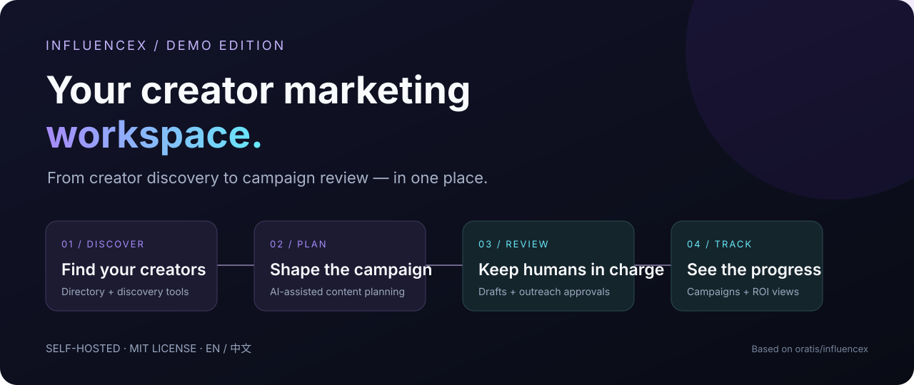
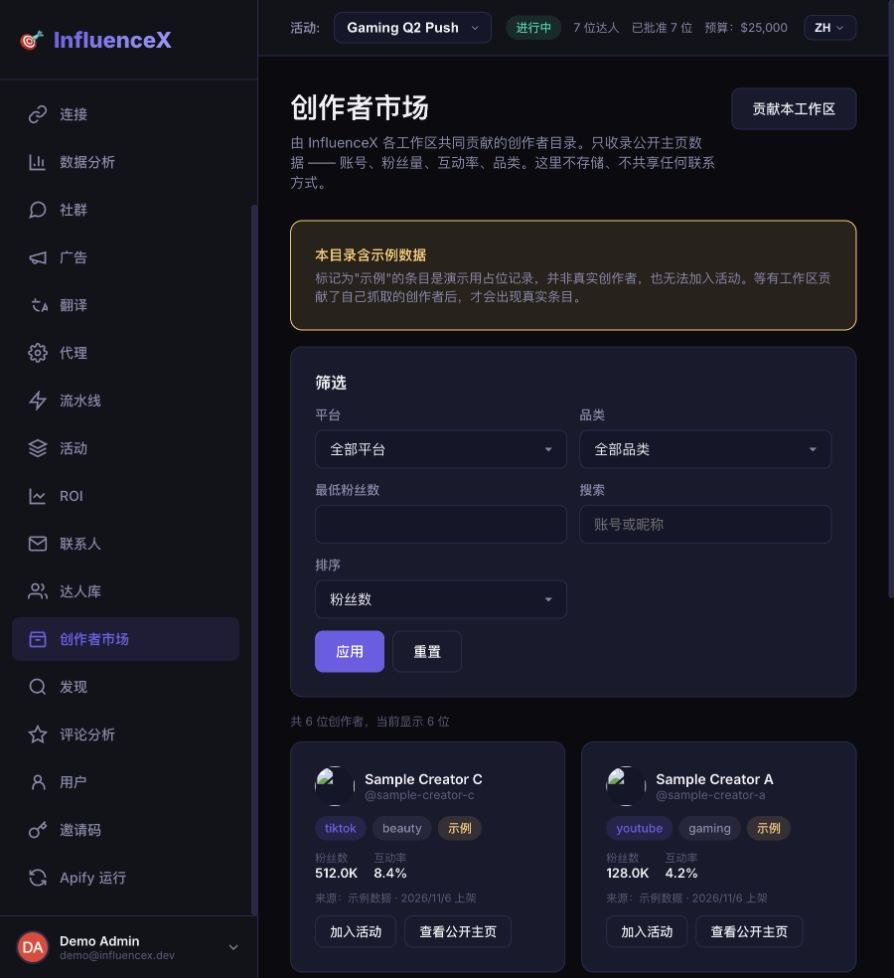
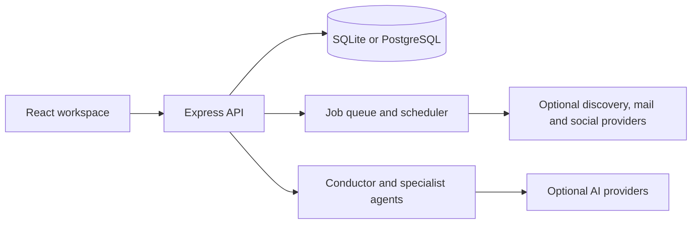

<div align="center">



# InfluenceX · Creator Marketing Workspace

**Discover creators. Plan content. Review outreach. Track campaigns.**

A self-hostable workspace for creator partnerships and AI-assisted marketing.

[English](README.md) · [简体中文](README.zh-CN.md) · [Live site](https://influencex-kikm.onrender.com) · [Quick start](#quick-start) · [Roadmap](docs/ROADMAP.md)

[](LICENSE)
[](https://github.com/Ruizchow/influencex-demo/actions/workflows/ci.yml)
[](docs/DEPLOYMENT.md)
[](README.zh-CN.md)

</div>

## Why this project?

Creator marketing spans research, spreadsheets, email drafts, content calendars, and reporting. InfluenceX brings those steps into a single workspace with an AI planning assistant and reviewable outputs.

This repository is **Ruizchow's demo and deployment edition of [oratis/influencex](https://github.com/oratis/influencex)**. It retains the upstream MIT license and contributors' attribution. The hosted UI currently uses the name **Zirui Marketing OS**.

## What you can do

| Workflow | What is included | What you need |
| --- | --- | --- |
| Manage partnerships | Creator records, campaigns, contacts, pipeline and ROI views | Local app + account |
| Explore creators | Marketplace UI, discovery tools and sample directory | API credentials for real discovery |
| Plan and draft | Conductor, research, writing, translation and content tools | A supported LLM provider for AI execution |
| Review outreach | Drafts, approval stages and campaign context | Mail provider credentials for sending |
| Organize publishing | Content calendar, connections and publishing workflows | Platform OAuth credentials / permissions where required |
| Collaborate | Workspaces, role-based access and invite codes | Admin-created invitations |

**No API keys are needed to start the app and explore the seeded workspace.** Real AI generation, scraping, email and platform publishing depend on configured providers and may incur their own charges. Connector capabilities vary by platform; do not assume every channel supports unattended publishing.

## Preview

[Open the live site →](https://influencex-kikm.onrender.com)

The public homepage is accessible without an account. The workspace requires an invitation; there is **no shared public administrator password**. For a complete hands-on trial, run your own instance using the steps below.

The hosted instance runs on Render Free: it can take around a minute to wake after inactivity, and demo data can reset. It is a preview, not a durable place to store your work.

<details>
<summary>See the creator marketplace (local sample workspace)</summary>



Local sample-data screenshot. Names and metrics are illustrative; the current hosted branding and data can differ. Placeholder profile images may be unavailable.

</details>

## Quick start

Use Node.js 24 LTS and npm. SQLite is the default; a separate database is optional.

```bash
git clone https://github.com/Ruizchow/influencex-demo.git
cd influencex-demo
npm ci --legacy-peer-deps
npm --prefix client ci --legacy-peer-deps
npm --prefix client run build
npm run setup:local
npm start
```

`setup:local` creates a local `.env` with a random admin password and encryption key, and prints your local login details. It **refuses to overwrite an existing `.env`**. Save those details locally; never commit the `.env` file.

Open **http://localhost:8080/#/login**. The first server start creates your administrator, workspace, and sample campaign. For hot reload, also run `npm run dev:client` in another terminal and open the Vite URL.

### Docker

```bash
git clone https://github.com/Ruizchow/influencex-demo.git
cd influencex-demo
# Requires Node.js for the configuration helper; no npm install needed here.
node scripts/setup-local.cjs
docker compose up --build -d
```

Open **http://localhost:8080/#/login** using the credentials printed by the helper. Compose stores SQLite in a named volume. `docker compose down` keeps it; `docker compose down -v` deletes it.

### Deploy your own instance on Render

[](https://render.com/deploy?repo=https://github.com/Ruizchow/influencex-demo)

The included Blueprint requests a Free web service. Supply **ADMIN_EMAIL** and **ADMIN_PASSWORD** when prompted and confirm the selected plan before deploying. Missing credentials leave you without an initial admin. [Complete deployment and troubleshooting guide →](docs/DEPLOYMENT.md)

## Configure only what you use

Start with the generated `.env`. Add optional values from [.env.example](.env.example), then restart the app.

- **AI:** `ANTHROPIC_API_KEY`, `OPENAI_API_KEY`, or `GOOGLE_AI_API_KEY`.
- **Discovery:** `YOUTUBE_API_KEY`, `APIFY_TOKEN`, and optionally `HUNTER_API_KEY`.
- **Email:** configure Resend or the supported mailbox connection flow before sending.
- **Social accounts:** supply the relevant provider OAuth credentials and connect an account in the UI.
- **Storage:** set `DATABASE_URL` for PostgreSQL; otherwise SQLite is used.

The public [API documentation](https://influencex-kikm.onrender.com/api/docs) describes endpoints. On your own instance, use `/api/docs` and `/healthz`.

## Architecture



React 18 · Vite · Express 5 · SQLite / PostgreSQL · optional Redis / BullMQ.

## Contribute

Useful first contributions: improve an empty state, add a translation, reproduce a connector issue, or improve the setup guide. See [CONTRIBUTING.md](CONTRIBUTING.md) and the [roadmap](docs/ROADMAP.md).

[Report a bug](https://github.com/Ruizchow/influencex-demo/issues/new?template=bug_report.yml) · [Suggest a feature](https://github.com/Ruizchow/influencex-demo/issues/new?template=feature_request.yml)

If this saves you time, **star the repository** so you can find it again and follow its progress. A reproducible issue or useful PR is just as welcome.

## Credits and license

Built on [oratis/influencex](https://github.com/oratis/influencex), by the InfluenceX contributors. This edition adds deployment fixes, local onboarding and project documentation. See [NOTICE.md](NOTICE.md) for provenance and [LICENSE](LICENSE) for the full MIT license.
