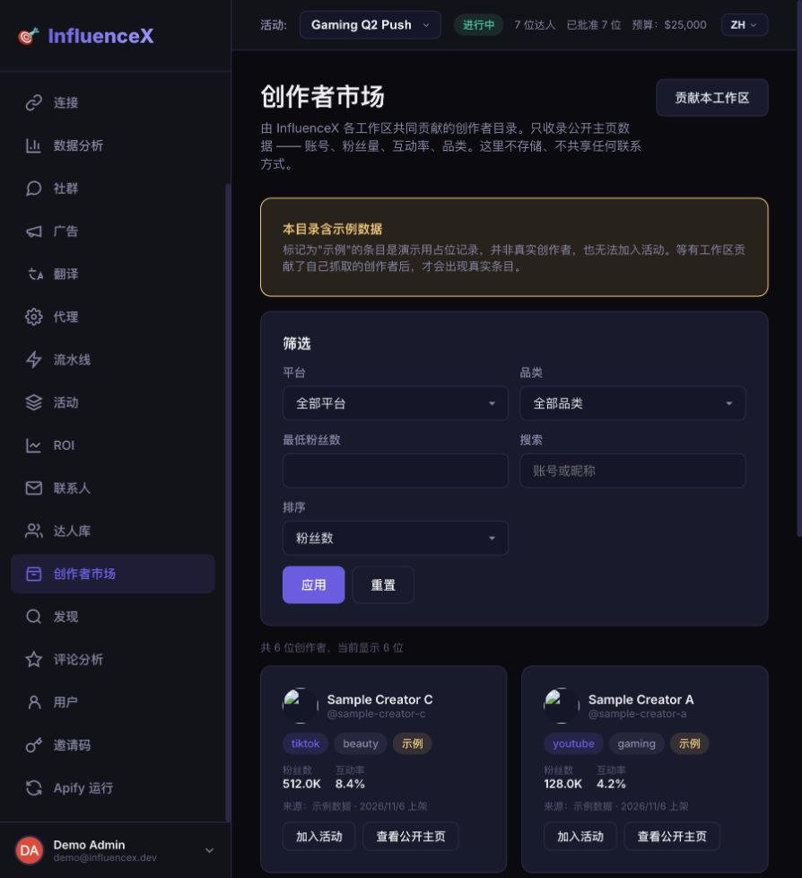

<div align="center">


# InfluenceX · 创作者营销工作台

**发现创作者、规划内容、审核外联、管理活动，在一个工作区完成。**

[English](README.md) · 简体中文 · [在线站点](https://influencex-kikm.onrender.com) · [部署指南](docs/DEPLOYMENT.md) · [路线图](docs/ROADMAP.md)

[](LICENSE)
[](https://github.com/Ruizchow/influencex-demo/actions/workflows/ci.yml)

</div>

## 适合谁？

适合想把创作者资料、合作进度、内容计划和外联审核放在同一个地方的小团队，也适合希望研究或二次开发营销工作流的开发者。

这是 Ruizchow 基于 [oratis/influencex](https://github.com/oratis/influencex) 整理的演示与部署版本，保留上游 MIT 许可证及贡献者署名。线上界面目前显示为 **Zirui Marketing OS**。

## 能做什么？

| 场景 | 已有功能 | 使用条件 |
| --- | --- | --- |
| 创作者合作 | 创作者库、活动、联系人、合作流水线、ROI 页面 | 启动应用并登录 |
| 创作者发现 | 市场目录、筛选、发现工具 | 真实数据采集需要 API 配置 |
| AI 内容规划 | Conductor、研究、写作、翻译等工具 | 执行 AI 任务需要模型服务密钥 |
| 外联审核 | 草稿、审批流程、活动上下文 | 发送邮件需要邮件服务 |
| 内容发布 | 日历、账号连接、发布流程 | 部分操作需要 OAuth 授权，能力因平台而异 |
| 团队协作 | 多工作区、角色、邀请码 | 管理员创建邀请 |

**本地浏览界面和示例工作区不需要购买 API。** AI 生成、真实采集、发信和社交平台发布需要各自的服务配置，可能产生第三方费用。

## 先看看

[打开在线站点 →](https://influencex-kikm.onrender.com)

公开首页无需登录，内部工作区需要邀请；不会公开共享管理员密码。希望完整体验的朋友可以按下面的步骤运行自己的实例。

线上使用 Render Free，闲置后首次打开可能要等约一分钟，演示数据也可能重置。

<details>
<summary>创作者市场截图（本地示例数据）</summary>



截图来自本地示例工作区，人物和指标均为示例，当前线上品牌及数据可能不同。示例头像可能无法加载。

</details>

## 本地启动

准备 Node.js 24 LTS 和 npm，无需先安装数据库。

```bash
git clone https://github.com/Ruizchow/influencex-demo.git
cd influencex-demo
npm ci --legacy-peer-deps
npm --prefix client ci --legacy-peer-deps
npm --prefix client run build
npm run setup:local
npm start
```

`setup:local` 会创建 `.env`，生成随机管理员密码及加密密钥，并在终端显示本地登录信息；已有 `.env` 时不会覆盖。请自行保存登录信息，不要提交 `.env`。

打开 **http://localhost:8080/#/login**。首次启动会创建管理员、工作区和示例活动。

### Docker / Render

Docker：运行 `node scripts/setup-local.cjs` 后执行 `docker compose up --build -d`，访问同一地址。Compose 使用命名卷保存 SQLite 数据。

Render：使用 [一键部署入口](https://render.com/deploy?repo=https://github.com/Ruizchow/influencex-demo)，填写 `ADMIN_EMAIL` 和 `ADMIN_PASSWORD`，确认 Free 套餐后部署。详细操作见[部署及登录排错指南](docs/DEPLOYMENT.md)。

## 参与项目

欢迎提交界面问题、中文翻译、安装反馈和复现步骤。请先阅读[贡献指南](CONTRIBUTING.md)；后续计划见[路线图](docs/ROADMAP.md)。

如果这个项目对你有用，可以点一个 **Star**，方便以后找回来，也帮助更多人发现它。

## 来源与许可

基于 [oratis/influencex](https://github.com/oratis/influencex)。本版本的增量包括部署修复、本地初始化和项目文档。原作者及贡献者署名见 [NOTICE.md](NOTICE.md)，完整 MIT 许可证见 [LICENSE](LICENSE)。
